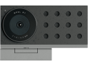
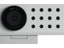
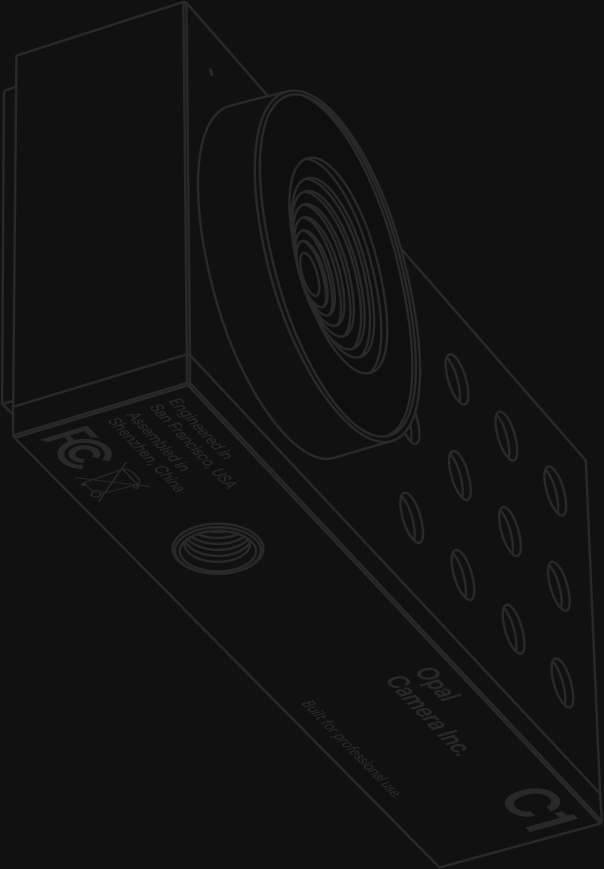

# Opal C1 Firmware & Bootloader Toolkit

<p align="center">
  
  &nbsp;&nbsp;&nbsp;&nbsp;
  
</p>

<p align="center">
  
</p>

Offline firmware archive, diagnostic, and SPI flash upgrade/restore toolkit for the **Opal C1** webcam (`Intel Movidius Myriad X MA2485`, `0x03e7:0xf63d`, Sony `IMX582` 48 MP sensor).

---

## Why

1. **Preserving the Opal C1 Firmware Offline:** Nothing guarantees how long `updates.opal.camera` or the Opal Composer macOS app will remain online. This repository archives the complete stock Opal C1 SPI application image, bootloader, and Sony IMX582 ISP tuning blobs directly in git.
2. **Fixing the `v0.0.15` Bootloader Hang:** The Opal C1 ships from the factory with a `2021`-era Luxonis USB bootloader (`v0.0.15`) in SPI flash (`0x000000`). Bootloader versions `< 0.0.28` suffer from a known Myriad X soft-reset/watchdog race condition where the camera fails to re-enumerate over USB after a session closes or resets. Upgrading the SPI bootloader partition to **`v0.0.29`** while leaving Opal's standalone UVC + Mic application partition at `0x100000` untouched fixes soft-reboot recovery.
3. **USB Hub / Dock Link-Training Detection:** The C1's SPI bootloader config sets `timeoutMs: 0`, giving the USB host only ~150 ms to negotiate 5 Gbps SuperSpeed before the Myriad X resets its USB PHY and boots the C1 firmware. Intermediate Thunderbolt/USB hubs frequently fail this handoff, so the tools inspect the macOS `IOUSBHostDevice` tree and warn when the camera is not plugged directly into a host port.

---

## How

All tasks run via [`mise`](https://mise.jdx.dev) and [`uv`](https://docs.astral.sh/uv/) and automatically point to the committed binaries in [`firmware/`](firmware/):

```bash
# 1. Inspect USB topology, Myriad X thermals/RAM, sensor modes, EEPROM, and SPI bootloader
mise run inspect

# 2. Dump a full 16 MiB SPI flash backup + decode the embedded SBR pipeline and assets
mise run backup

# 3. Upgrade the SPI USB bootloader from v0.0.15 -> v0.0.29 (leaves C1 app @ 0x100000 intact)
mise run flash

# 4. Restore stock Opal v0.0.15 bootloader, standalone C1 app, or raw SPI flash backup
mise run restore --target opal-bootloader
mise run restore --target opal-application
mise run restore --target full-backup

# 5. Re-fetch/verify binaries from Luxonis Artifactory or the Opal Composer DMG
mise run download --source opal
mise run download --source luxonis
```

Run `mise run <task> --help` for detailed flag descriptions.

---

## Committed Firmware ([`firmware/`](firmware/))

* [`firmware/opal-c1/application/opal-c1-standalone.sbr`](firmware/opal-c1/application/opal-c1-standalone.sbr) (`11.0 MiB`) — Complete SPI flash `BR__` SBR application partition (`0x100000..0x00bfe57e`) containing the standalone Opal C1 UVC video + UAC2 microphone firmware, 9-node `libnop` pipeline, and embedded assets.
* [`firmware/opal-c1/bootloader/depthai-bootloader-usb.cmd`](firmware/opal-c1/bootloader/depthai-bootloader-usb.cmd) (`735 KiB`) — Stock Opal C1 USB bootloader (`v0.0.15`).
* [`firmware/opal-c1/device/depthai-device-fwp-e2929eb3993d759114d7084074a0eec845c12b45.tar.xz`](firmware/opal-c1/device/depthai-device-fwp-e2929eb3993d759114d7084074a0eec845c12b45.tar.xz) (`8.0 MiB`) — Stock Opal C1 device firmware archive extracted from `Opal Composer 2.0.0 (24)`.
* [`firmware/opal-c1/resources/`](firmware/opal-c1/resources/) — Sony IMX582 ISP camera tuning ([`Opal582_v2.bin`](firmware/opal-c1/resources/Opal582_v2.bin)), filter pipelines (`*_pipeline.json`), and neural network blobs.
* [`firmware/luxonis/bootloader/depthai-bootloader-usb.cmd`](firmware/luxonis/bootloader/depthai-bootloader-usb.cmd) (`770 KiB`) — Upgraded USB bootloader (`v0.0.29`).
* [`firmware/manifest.json`](firmware/manifest.json) — SHA-256 checksums and provenance metadata.
